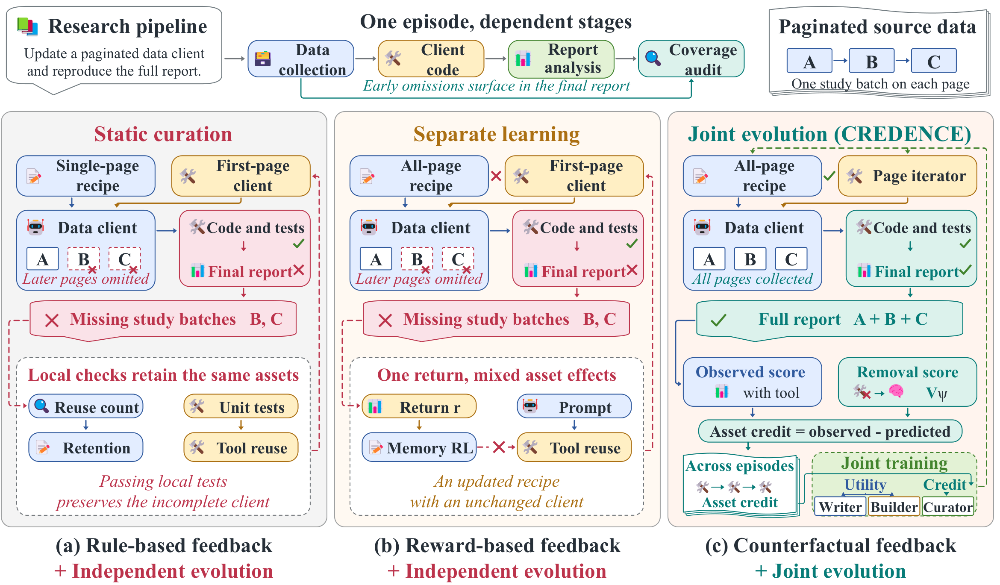

# CREDENCE: Co-Evolving Memory, Tools, and Curation for Long-Horizon Agents via Counterfactual Credit

Open-source code for the paper.

Long-horizon language agents accumulate memories and reusable tools to improve across tasks. Existing approaches use separate or episode-level feedback, yet asset creation and curation are coupled, and individual contributions can emerge much later. To address these challenges, we propose CREDENCE, which jointly trains a memory writer, tool builder, and curator. Accumulated credit returns delayed utility to creators, while a calibrated margin guides curation.



Comparison of store evolution strategies. CREDENCE co-trains the memory writer, tool builder, and curator with counterfactual credit computed from the observed score and the predicted score under asset removal.

## Installation

Python 3.10 or later.

```bash
pip install -e ".[models,test]"
```

## Usage

Prepare recorded head examples and official benchmark interfaces as described in [input preparation](docs/execution.md).

```bash
python -m credence sft --config configs/qwen3_8b.yaml \
  --examples data/head_examples.jsonl --output checkpoints/warm_start
python -m credence train --config configs/qwen3_8b.yaml \
  --tasks data/tasks.jsonl --environments configs/environments.json \
  --warm-start checkpoints/warm_start --output results/credence
```

[Configurations](configs) specify the two backbones. Use `python -m credence --help` for evaluation and checkpoint continuation.

## Software checks

```bash
pytest -q -p no:cacheprovider
```

The code uses the [MIT License](LICENSE). The displayed image is from the paper.
