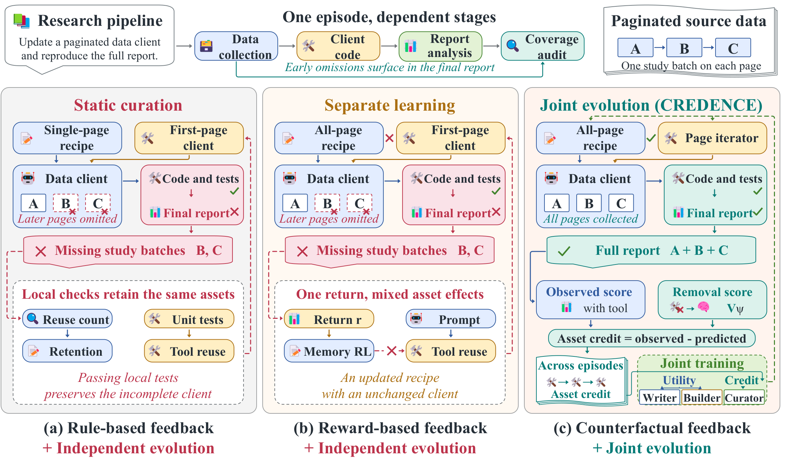
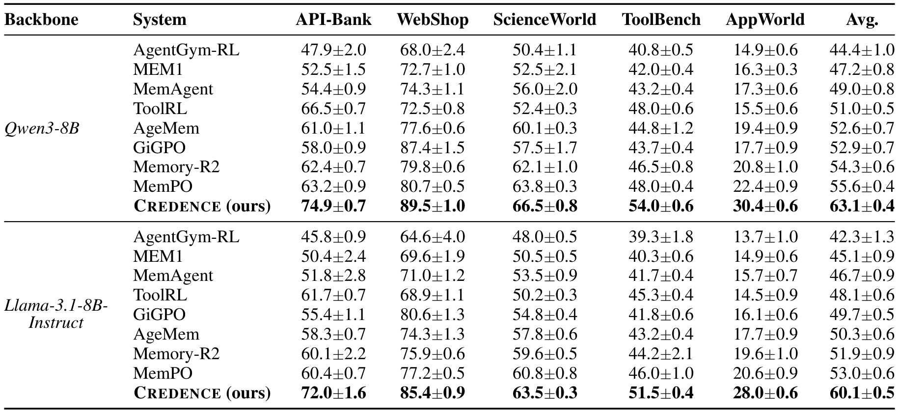

# CREDENCE: Co-Evolving Memory, Tools, and Curation for Long-Horizon Agents via Counterfactual Credit

Long-horizon language agents accumulate memories and reusable tools to improve
across tasks. Existing approaches use separate or episode-level feedback, yet
asset creation and curation are coupled, and individual contributions can emerge
much later. To address these challenges, we propose CREDENCE, which jointly
trains a memory writer, tool builder, and curator. We therefore supervise joint
learning through counterfactual removal effects that quantify asset utility.
Specifically, an outcome model predicts task scores after asset removal, and the
difference from observed scores estimates each asset’s contribution. Accumulated
credit returns delayed utility to creators, while a calibrated margin guides
curation. During joint training, matched continuations preserve candidate
comparisons until these rewards mature, allowing all three policies to adapt as
stores evolve. To characterize when accumulated credit supports curation, we
derive a conditional sign certificate under bounded estimation error. We
evaluate CREDENCE on five public benchmarks covering tool calling, web shopping,
interactive science, tool use, and API programming. Across Qwen3-8B and
Llama-3.1-8B-Instruct, it improves average performance by 7.5 and 7.1 points
over the strongest baseline. Ablations support the complementary roles of joint
training and removal-based credit, while calibration shows 99.2% sign agreement
on acted decisions.

## Algorithm Flow

To learn asset creation and maintenance together, CREDENCE jointly trains three policies.

1. Initialize stores, credit records, and group buffer.
2. For each collection batch, process the stream episodes. Retrieve assets by greedy coverage, execute the task, and record its trajectory, score, and pool.
3. Compute retrieval credit and update version records and creator rewards. Sample same-prompt groups for creation and eligible curation, then validate their outputs.
4. Launch matched continuations and process restoration queries.
5. Release matured groups within the policy lag limit. Compute group advantages and update policies, encoder, and predictor.



**Figure 1.** Comparison of store evolution strategies. (a) Reuse and local test signals for retention. (b) Memory decisions trained from episode returns while tool evolution follows its own signal. (c) CREDENCE, which co-trains the memory writer, tool builder, and curator with counterfactual credit computed from the observed score and the predicted score under asset removal.

## Results

**Table 1.** Main results under official evaluation settings, as mean and standard deviation over three training seeds on a 0–100 scale. AppWorld measures transfer. Avg. is the unweighted five-benchmark mean. Bold marks the best result per backbone.



**Joint training with asset credit improves task performance.** Table 1 shows gains on all five benchmarks. On Qwen3-8B, CREDENCE improves the average from MemPO’s 55.6 to 63.1. Gains over each column’s strongest baseline are 8.4 points on API-Bank, 8.0 on AppWorld, 2.1 on WebShop, 6.0 on ToolBench, and 2.7 on ScienceWorld. The pattern supports learning reusable asset utility across interaction environments.

**The gains extend to a second backbone and transfer tasks.** On Llama-3.1-8B-Instruct, the average increases from 53.0 to 60.1, improving every benchmark. AppWorld rises from 20.6 to 28.0, supporting transfer of learned asset operations to an environment excluded from training.

## Getting Started

### Environment Setup

Use Python 3.10 or later and install PyTorch for your system.

```bash
python -m venv .venv
source .venv/bin/activate
python -m pip install -e '.[models]' \
  --index-url https://pypi.tuna.tsinghua.edu.cn/simple
export HF_ENDPOINT=https://hf-mirror.com
```

### Data Preparation

Install the benchmark environments and prepare the training and evaluation tasks
following the [data guide](docs/execution.md). Set the environment paths in
[configs/environments.json](configs/environments.json) and choose a model profile
from [configs/](configs).

### Training and Evaluation

Collect warm-start examples and train the initial policy adapters:

```bash
python -m credence collect-warm-start --config configs/qwen3_8b.yaml \
  --tasks data/tasks.jsonl --environments configs/environments.json \
  --output data/warm_start

python -m credence sft --config configs/qwen3_8b.yaml \
  --examples data/warm_start/head_examples.jsonl \
  --output checkpoints/warm_start
```

Initialize joint training with the adapters trained above:

```bash
python -m credence train --config configs/qwen3_8b.yaml \
  --tasks data/tasks.jsonl --environments configs/environments.json \
  --warm-start checkpoints/warm_start --output results/credence
```

Evaluate the trained checkpoint on the benchmark tasks:

```bash
python -m credence run --checkpoint results/credence/checkpoint \
  --tasks data/evaluation.jsonl --environments configs/environments.json \
  --output results/evaluation
```

## License

[MIT License](LICENSE).
